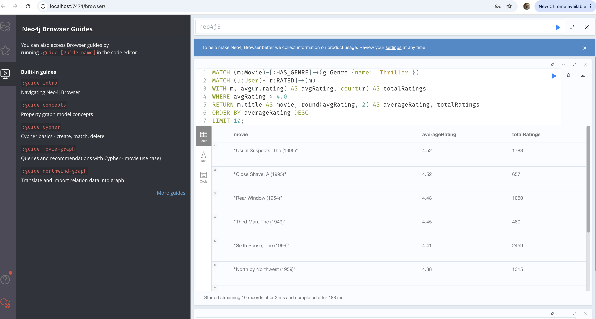
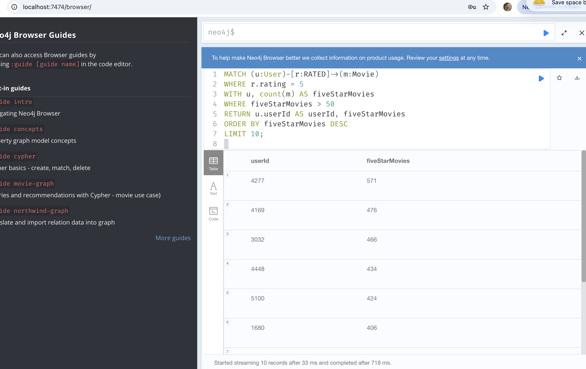
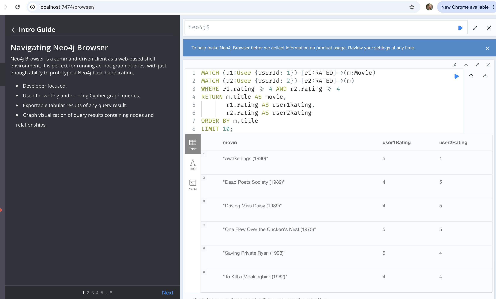
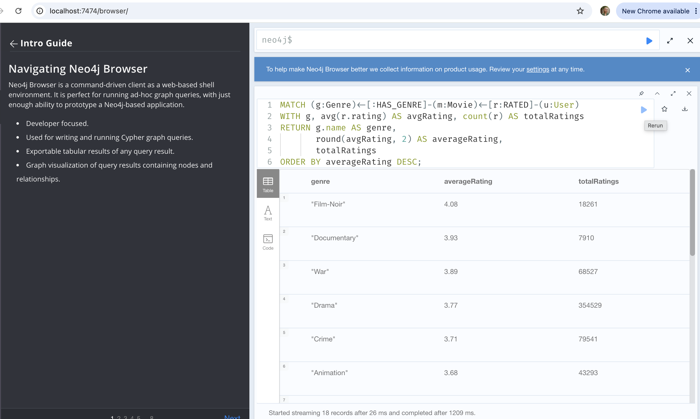
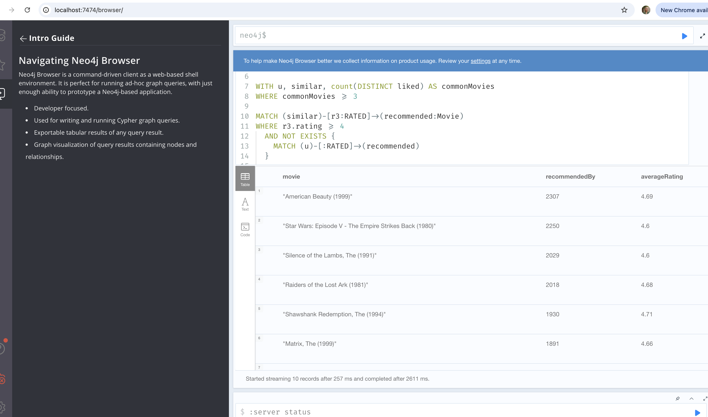
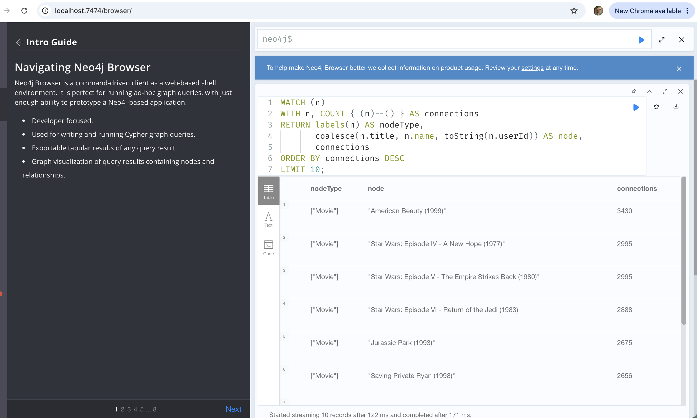
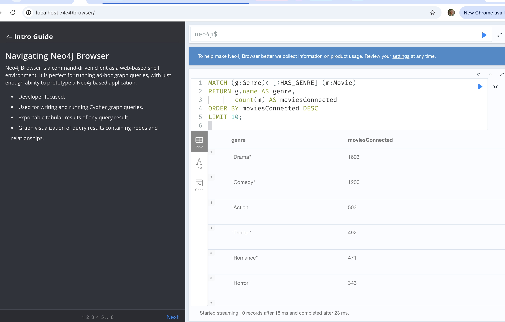

# NoSQL Homework 3 — MovieLens with Neo4j

## What I did

For this homework I used Neo4j to work with the MovieLens 1M dataset. I loaded users, movies, genres, and ratings into a graph database. Then I wrote Cypher queries to find highly rated movies, compare users, and try a simple movie recommendation. I also checked which nodes have many connections.

I ran Neo4j locally with Docker. I completed Parts 1, 2, 3, 4, and 6. I did not do Part 5 because the graph algorithms were optional.

## Part 1 — My graph schema

I used three types of nodes: `User`, `Movie`, and `Genre`.

```text
(User {userId, gender, age, occupation})
     |
     | RATED {rating, timestamp}
     v
(Movie {movieId, title, year})
     |
     | HAS_GENRE
     v
(Genre {name})
```

**Why I made these choices**

A user, a movie, and a genre are separate things, so I made each one a node. A rating connects a user to a movie. I used a `RATED` relationship and saved the score and timestamp on that relationship.

I could make each rating a separate `Rating` node. That would be useful if ratings had more information or needed their own connections. For this homework, I only needed the score and the time. A relationship is simpler because I can go directly from a user to a movie.

I made genres separate nodes instead of storing them only as a list inside `Movie`. This makes it easy to find all Thriller movies or see how many movies belong to Drama. A movie can connect to several genres without repeating the genre name in different queries. The downside is that popular genres have many relationships, which can make some graph queries more expensive.

## Part 2 — Loading the data

I used the MovieLens 1M dataset. The original files use `::` between values and Latin-1 text encoding. I wrote `convert.py` to make normal UTF-8 CSV files for Neo4j.

I created indexes for `User.userId`, `Movie.movieId`, and `Genre.name` before loading the relationships. The indexes help Neo4j find existing nodes. I used `MERGE` for nodes and relationships so that running the queries again would not create duplicates.

I loaded ratings with `apoc.periodic.iterate` and a batch size of 1,000. I kept `parallel: false` to avoid possible problems with several batches writing to the same graph at the same time. The full import query is in `part2_load.cypher`.

Here are the counts I checked in Neo4j:

| Data | Count |
| --- | ---: |
| Users | 6,040 |
| Movies | 3,883 |
| Genres | 18 |
| Rating relationships | 1,000,209 |
| Movie-to-genre relationships | 6,408 |

The counts match the data I loaded. I used `MERGE` to avoid duplicate nodes, but I did not separately run a duplicate-check report.

## Part 3 — My Cypher queries

All six queries are saved in `queries/part3.cypher`. I ran them in Neo4j Browser and saved screenshots of the results.

### Query 1 — Thriller movies with an average rating above 4

I first matched movies connected to the Thriller genre. Then I used `avg()` to calculate each movie's average rating and `count()` to count the ratings. I kept movies with an average above 4 and showed the top 10.

In my result, *The Usual Suspects (1995)* and *A Close Shave (1995)* both had an average rating of 4.52. *Rear Window (1954)* had 4.48. The number of ratings matters too. A movie with only a few ratings is different from one with over 1,000 ratings.



### Query 2 — Users who gave more than 50 ratings of 5

I matched the `RATED` relationships where `rating = 5`, counted them for each user, and kept users with more than 50. This counts only their ratings of 5, not all the movies they rated.



### Query 3 — Movies liked by both users

I checked users 1 and 2. The query matches the same movie from both users and keeps it only when both ratings are at least 4. I return each user's score, so I can compare them.



### Query 4 — Average rating by genre

I followed the connections from genres to movies and their ratings. Then I calculated the average score and number of ratings for every genre. One movie may have more than one genre, so its rating can be included in more than one genre's average.

I included the number of ratings because the average alone does not tell the whole story.



### Query 5 — Simple movie recommendations

For user 1, I first found movies they rated 4 or 5. I found other users who also liked at least three of those movies. Then I looked at other movies these users rated highly.

I excluded movies user 1 had already rated. I sorted the results by how many similar users recommended each movie. This is a basic recommendation method, not a complete recommendation system. For example, it does not measure how different the users' tastes are outside those shared movies.



### Query 6 — Shortest path between two users

I used `shortestPath()` to find a connection between users 1 and 2 through `RATED` relationships. I searched paths of up to six relationships.

My result was:

```text
User 1 -> Awakenings (1990) -> User 2
Length: 2
```

This means both users rated *Awakenings (1990)*. The path has two steps because it follows two relationships.

A path of length 4 could look like this:

```text
User A -> Movie 1 -> User B -> Movie 2 -> User C
```

A path of length 6 has one more movie and one more user in the middle. A short path means users are connected through rated movies. It does **not** automatically mean they liked the same movies, because the path does not check the rating scores.


## Part 4 — Supernodes

I ran a query to find nodes with the most relationships. The query counts all relationships, so a movie's number includes user ratings and its genre connections.

Some of my results were:

| Movie | Connections |
| --- | ---: |
| American Beauty (1999) | 3,430 |
| Star Wars: Episode IV - A New Hope (1977) | 2,995 |
| Star Wars: Episode V - The Empire Strikes Back (1980) | 2,995 |
| Star Wars: Episode VI - Return of the Jedi (1983) | 2,888 |
| Jurassic Park (1993) | 2,675 |
| Saving Private Ryan (1998) | 2,656 |



I also checked genres. Drama had 1,603 movie connections, Comedy had 1,200, Action had 503, and Thriller had 492.



**Why supernodes can be slower:** If a query starts from a popular movie or genre, it may need to look through thousands of relationships. An index helps find the node, but it does not remove the work of following all its relationships. This is why a query involving a popular node can still take longer.

**What I would change:** For queries that only need a movie's genre, I could also store genre names as a property on the movie. Then a simple genre filter would not always need to visit a genre node with many connections. I would keep `Genre` nodes for graph exploration and only add this extra property if testing showed it helped. Another option is to start with more selective conditions, such as a movie or a small set of users, instead of starting with a large genre node.

## Part 6 — Neo4j compared with SQL

### 1. Which queries are more difficult in SQL?

I think the recommendation query (Query 5) and the shortest path query (Query 6) are easier to understand as graph queries. In Neo4j, I can follow relationships between users and movies directly. SQL can do the same work, but it usually needs joins. Finding a shortest path is especially less straightforward in SQL because it may need a recursive query.

For example, Query 3 checks for movies that both users 1 and 2 rated at least 4. In a SQL database with a `ratings` table, I could write:

```sql
SELECT m.title, r1.rating AS user1_rating, r2.rating AS user2_rating
FROM ratings r1
JOIN ratings r2 ON r1.movie_id = r2.movie_id
JOIN movies m ON m.movie_id = r1.movie_id
WHERE r1.user_id = 1
  AND r2.user_id = 2
  AND r1.rating >= 4
  AND r2.rating >= 4;
```

So this query is possible in SQL. It is just a different way to connect the same data. I would not say that SQL cannot do graph-like queries.

### 2. When would SQL be better?

I would use SQL for regular reports and big tables of statistics. For example, counting all ratings by year, grouping movies by genre, or exporting results to CSV would be very natural in SQL. Relational databases are also a good choice when the main work is filtering tables and calculating totals rather than following connections across many steps. Neo4j is useful here because the relationships are the main part of the homework, but it is not automatically faster for every query.

### 3. How could I improve my schema?

For **Query 1**, I could store genre names on each movie in addition to keeping `Genre` nodes. Then the query could filter movies by genre without going through a busy genre node. I would compare the query times before deciding whether this extra data is worth keeping.

For **Query 5**, I could save precomputed similarities between users as `SIMILAR` relationships after calculating their shared highly rated movies. Then recommendations would not need to find the same similar users from the full ratings graph every time. The problem is that these similarity connections would need updating when ratings change.

I already added indexes on user IDs, movie IDs, and genre names. These help find starting nodes, but they do not solve every performance problem. I would use `PROFILE` to check which steps are slow before adding more indexes or changing the graph.

## Files in this project

```text
Levchenko_nosql_3/
├── convert.py
├── docker-compose.yml
├── part2_load.cypher
├── queries/
│   ├── part3.cypher
│   └── part4_supernodes.cypher
├── screenshots/
│   ├── query1.png
│   ├── query2.png
│   ├── query3.png
│   ├── query4.png
│   ├── query5.png
│   ├── query6.png
│   ├── supernodes.png
│   └── genre_supernodes.png
└── README.md
```

The source data is from the [MovieLens 1M dataset](https://grouplens.org/datasets/movielens/1m/). I kept the downloaded dataset and generated CSV files locally instead of adding them to GitHub.

## How to run it

1. Install Docker and start Docker Desktop.
2. In the project folder, run `docker compose up -d`.
3. Download MovieLens 1M, unzip it into `ml-1m/`, and run `python3 convert.py`.
4. Open Neo4j Browser at `http://localhost:7474` and connect to the local database.
5. Run the statements in `part2_load.cypher` in order. The ratings step uses APOC for batch loading.
6. Run the queries in `queries/part3.cypher` and `queries/part4_supernodes.cypher` one at a time.

The local Neo4j password is set in `docker-compose.yml` for this homework setup only. I would not use that password for a public database.

## What I learned

This was my first time building this MovieLens graph in Neo4j. I liked being able to follow connections from a user to a movie and then to another user. The shortest-path example made this easy to see. I also learned that having many connections is not always good for query performance. Indexes are useful, but I still need to think about how many relationships a query visits.
